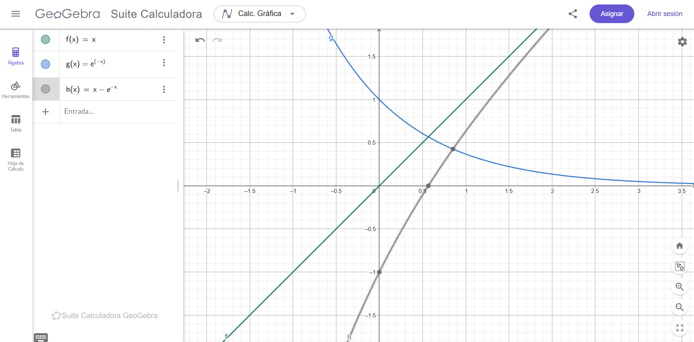

# Newton-Raphson

## Enunciado
Usar el método de Newton-Raphson para aproximar la solución de la ecuación:

x = e^(-x)

## 3. Gráfica en GeoGebra
Se graficaron y = x y y = e^(−x). El punto de intersección da la solución.



## 4. Código en Python
El algoritmo está en el archivo [newton_raphson.py](newton_raphson.py).

Para ejecutarlo:

```bash
python newton_raphson.py
```

**Salida:**
```
Raíz aproximada: 0.567143
x      = 0.567143
e^(-x) = 0.567143
f(x)   = ~1e-07
```

Se comprueba que x y e^(−x) coinciden, por lo que el algoritmo funciona.

## 5. Conclusiones
- El método aproximó la solución como **x ≈ 0,567** en solo 2 iteraciones.
- La convergencia es muy rápida.
- GeoGebra confirma el resultado: las curvas se cortan en x ≈ 0,567.
- La implementación en Python reproduce el cálculo manual.
- El método requiere una buena aproximación inicial y que f′(x) ≠ 0; aquí f′(x) = 1 + e^(−x) > 1, así que nunca se anula.
